# hyprhand mobile

Flutter Android client for [hyprhand](../hyprhand), a remote control for a Hyprland rig. It talks to the stock server over HTTP, `/ws` and `/ws/input`.

<p>
  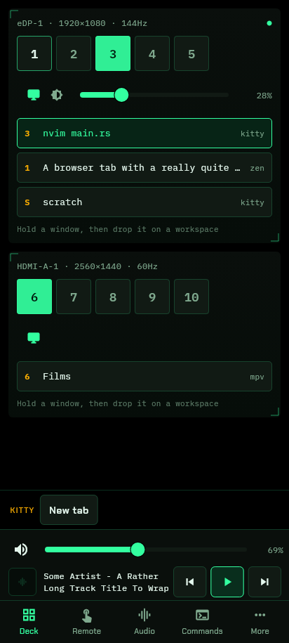
  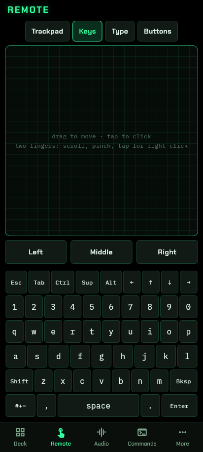
  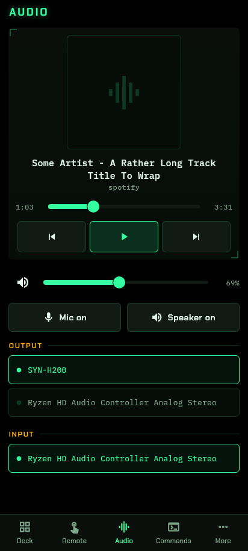
  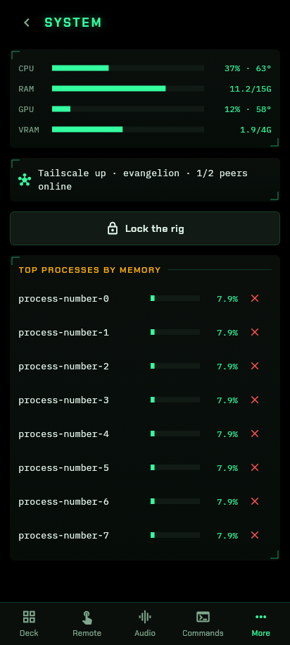
</p>

## Features

**Connecting**
- Saved rigs, Wi-Fi scan for rigs on the local network, or connect by address (LAN IP or Tailscale `*.ts.net`)
- PIN login, with a warning when the rig is on plain HTTP
- Switch between rigs or log out from Settings or the More tab

**Deck**: live view of every monitor
- Workspace buttons, DPMS toggle and brightness slider for each monitor
- Window list per monitor: hold a window and drop it on a workspace to move it
- Context buttons for the focused app (e.g. *New tab* in kitty)
- Volume and now-playing controls pinned to the bottom

**Remote**
- **Trackpad**: drag to move, tap to click, two-finger scroll, pinch, and two-finger tap to right-click, plus Left/Middle/Right buttons
- **Keys**: on-screen keyboard with Esc/Tab/Ctrl/Super/Alt/arrows next to the trackpad
- **Type**: send text straight to the rig
- **Buttons**: map the phone's volume and power buttons to chains of key combos and commands, with reordering, repeat while held and a test run. A standby face over the lock screen keeps the power-button mappings usable.

**Audio**: media player with seek and transport controls, volume, mic/speaker mute, and output/input device switching

**Commands**: one-tap buttons for shell commands defined on the rig, which you can add and manage from the phone

**Screen**: low-FPS live view of any monitor. In control mode you tap to click, drag to drag and hold to right-click. Also has zoom.

**Files**
- Grab a screenshot of a monitor or a webcam frame and save it to the gallery
- Send files to the rig (they land in `~/hyprhand-drop`), also available from Android's share sheet
- Two-way clipboard

**Modes**: trigger rig-defined modes such as *Focus* or *Movie*

**System**: CPU/RAM/GPU/VRAM usage and temperatures, Tailscale status, lock the rig, and top processes by memory with kill

**Config**: edit the rig's `commands`, `modes`, `context`, `fleet` and `theme` JSON in place

**Settings**
- Green, Amber, Ice or Auto theme (shared with the rig; the palette comes from its `/theme.css`)
- Volume keys control the rig, keep screen on, haptics, natural scrolling, CRT scanlines overlay, trackpad speed

## Screenshots

| Rig picker | Deck | Trackpad | Buttons |
|---|---|---|---|
| 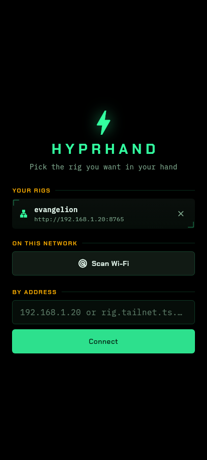 |  | 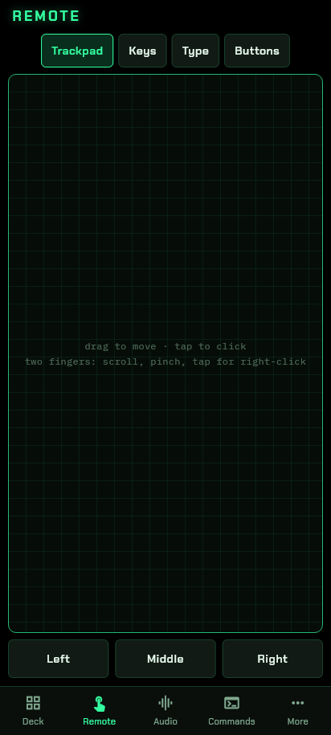 | 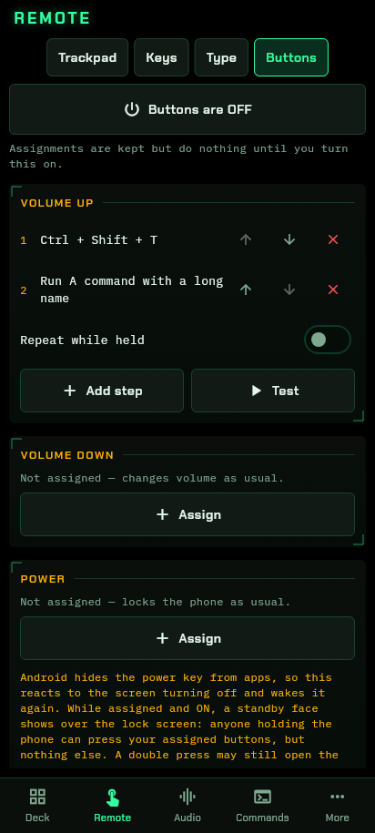 |

| Commands | Screen | Files | Config |
|---|---|---|---|
| 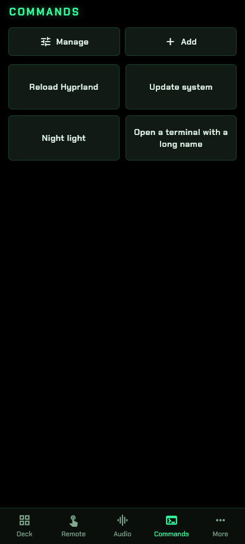 | 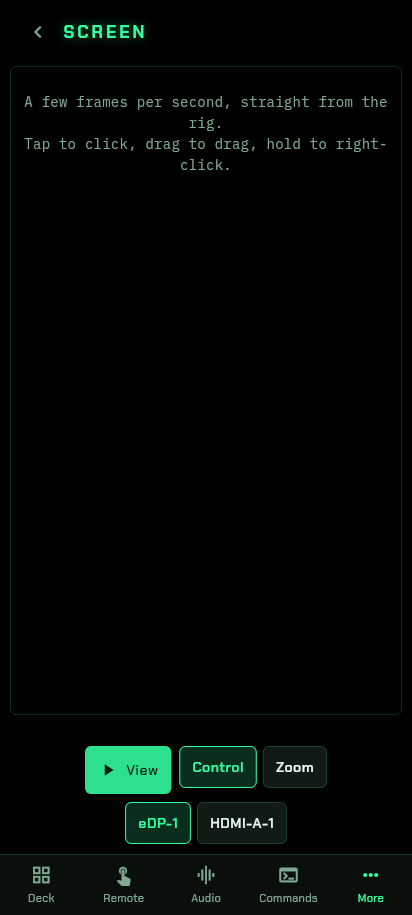 | 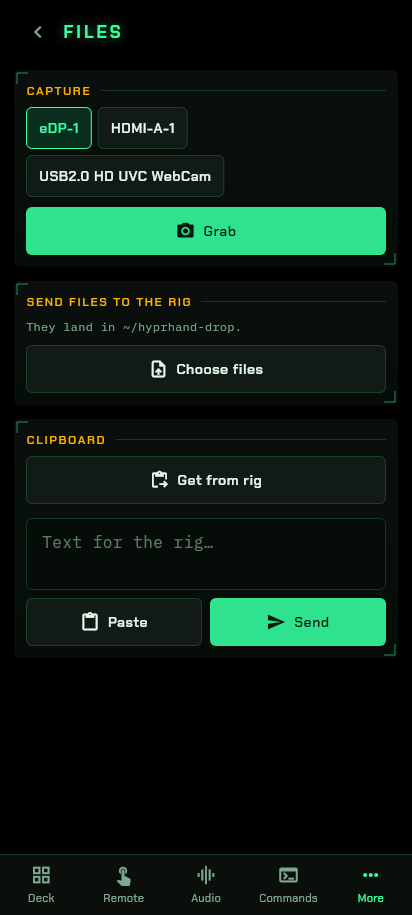 | 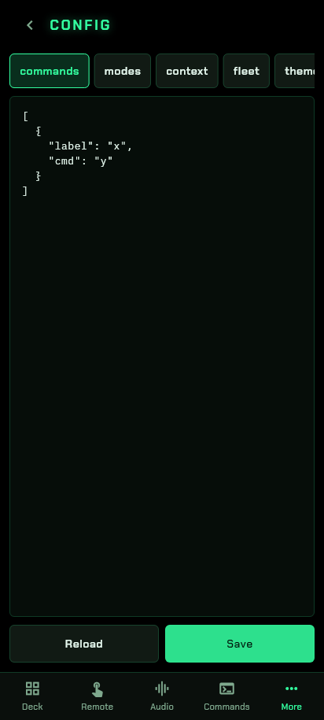 |

| Settings | Modes | More |
|---|---|---|
| 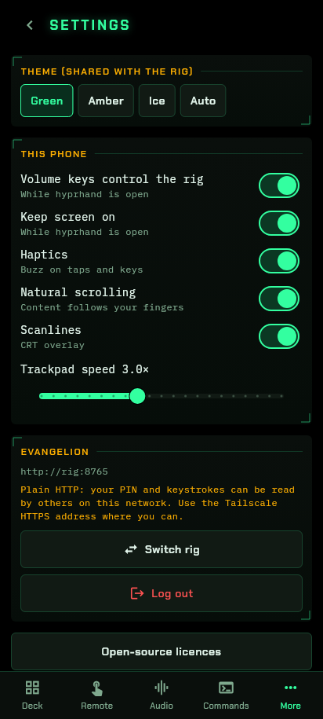 | 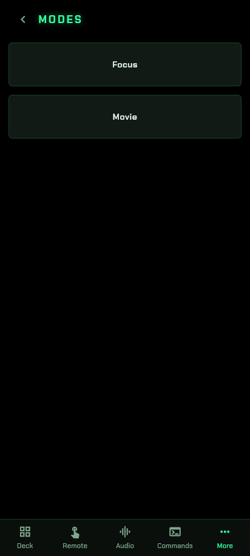 | 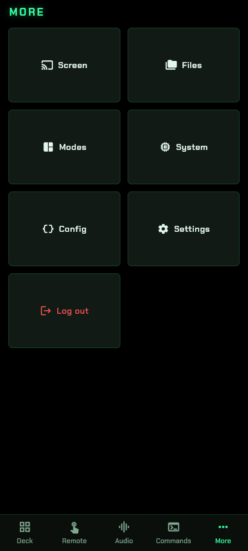 |

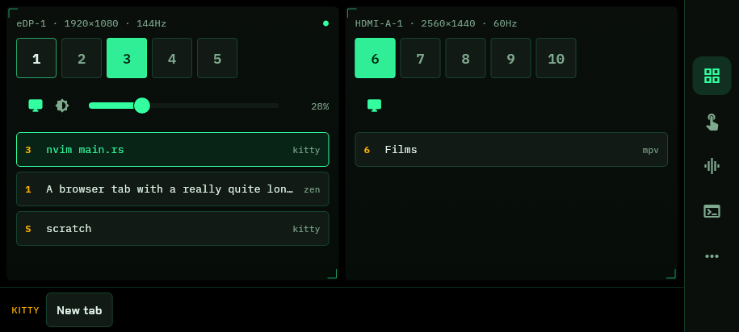

## Layout

- `lib/data`: models, HTTP client, reconnecting sockets, storage, native bridge
- `lib/blocs`: all state (flutter_bloc), plus the pure trackpad/keyboard logic
- `lib/ui`: screens; the palette comes from the rig's `/theme.css`
- `android/…/MainActivity.kt`: share target, volume keys, file picker, gallery save

## Build

```sh
flutter test
SHOTS=/some/dir flutter test test/screens_test.dart   # render every screen to PNG
flutter build apk --release --split-per-abi
```

Screenshots in `docs/screenshots` come from the `SHOTS` run above, using the `*-phone.png` renders.

Release builds are signed with the debug key until a signing config is added.
